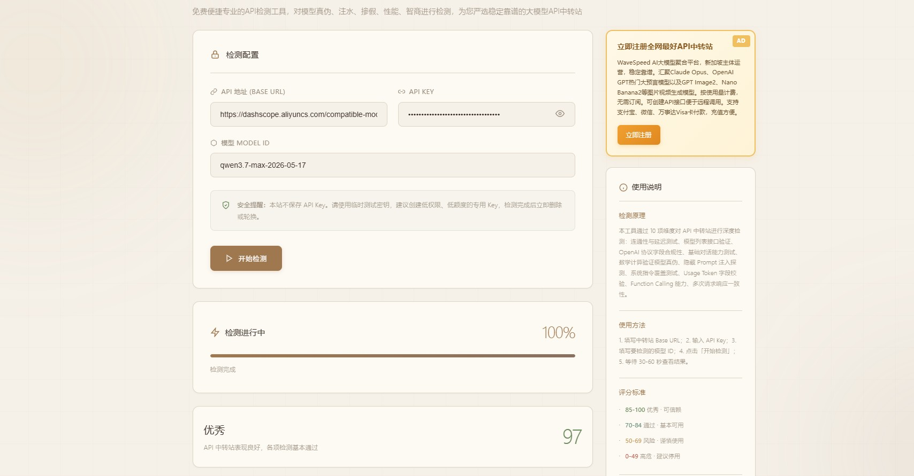
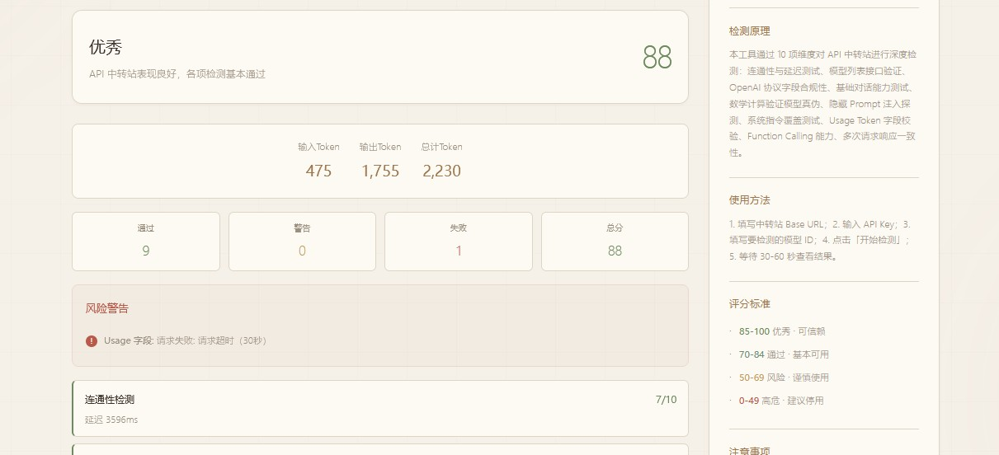

# 30秒一键检测！大模型中转站真假/注水/掺水/以次充好检测工具网站，专业稳定靠谱AI中转站聚合平台严选推荐！

## 为解决用户选购稳定靠谱的中转站聚合平台而生

AI大模型中转站已经是很多企业工作室用户的刚需。而面对目前市面上良莠不齐的API中转站市场，也确实让人抓耳挠腮的，这家到底靠不靠谱啊？有没有掺假注水以次充好啊？会不会随时跑路啊？

消费者不是怕花钱，而是怕花冤枉钱。事实是很多大模型中转站为了利润最大化，利用技术手段搞了一些猫腻，坑害消费者。作为普通用户，大多数人也许只能在价格上进行比较，无法对大模型API质量进行质量评估。而这就需要有一款普通人技术小白也能方便使用的“AI大模型API中转站检测工具”来对某一中转站进行检测，对是否确认使用该中转站进行一个评估参考。

## 巴士哥中转站质量检测小工具

这里我推荐这款“**[巴士哥AI大模型API中转站真假/注水/掺水检测工具](https://apitest.bashige.com/)**”，这款工具从10项技术维度对API进行检测，最后给出一个满分为100分的评分，用户可根据评分决定要不要使用这家API中转站。通过10项维度对API中转站进行深度检测：连通性与延迟测试、模型列表接口验证、OpenAI协议字段合规性、基础对话能力测试、数学计算验证模型真伪、隐藏Prompt注入探测、系统指令覆盖测试、Usage Token字段校验、Function Calling能力、多次请求响应一致性。

这款工具的使用方法也特别简单，仅需输入API接口的Base Url、Api Key、Model ID这三项，然后点击开始检测按钮，大约运行30秒左右就可以查看检测报告。

评分标准：

- 85-100 优秀 · 可信赖
- 70-84 通过 · 基本可用
- 50-69 风险 · 谨慎使用
- 0-49 高危 · 建议停用

平台不会保存用户的敏感Api Key信息，但还是建议使用一个临时的Api Key，测试完立即删除。当然了，此工具也并不是说100%准确，起到一个参考的作用吧，反正测试一下也没事，总比不测试好吧。

**2026年7月6日更新**：支持Claude Fable 5模型检测。

**2026年11月6日更新**：修复了一些Bug，让监测更准确。移除了碍眼的Google Adsense广告，让界面更简洁友好。添加了卜算子访客数据统计，根据真实IP统计本监测工具网站真实访客数量。

## 稳定靠谱的中转站导航
这里仅对一些我自己使用过的觉得还可以的GPT、Claude中转站进行汇总，不保证您用着就合适，选购中转站请擦亮眼睛仔细甄别！

**[久连大模型API中转站](https://9linkai.com/register?aff=BASHIGE)**，Claude与ChatGPT全系官方模型，一个API Key接入。每一个价格都并列官方公开价，官价6折！按实际用量计费，不降级、不替换、稳定靠谱。
