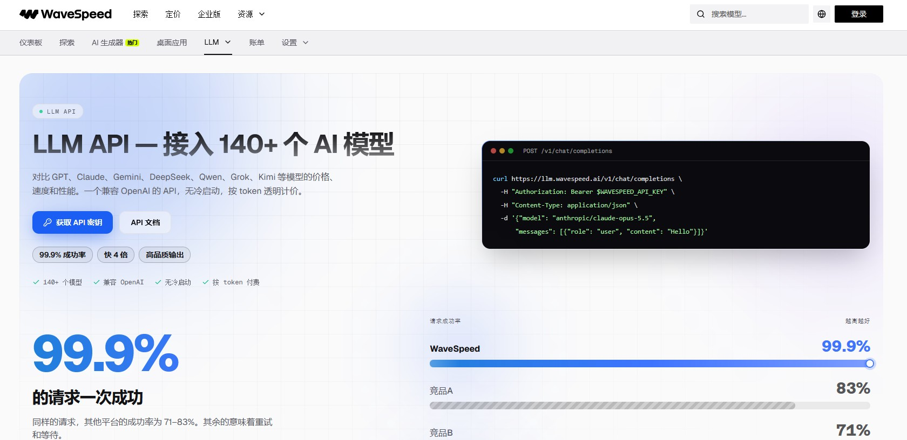
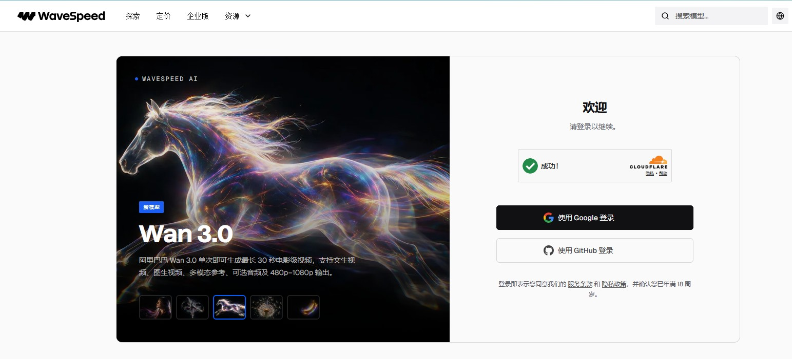
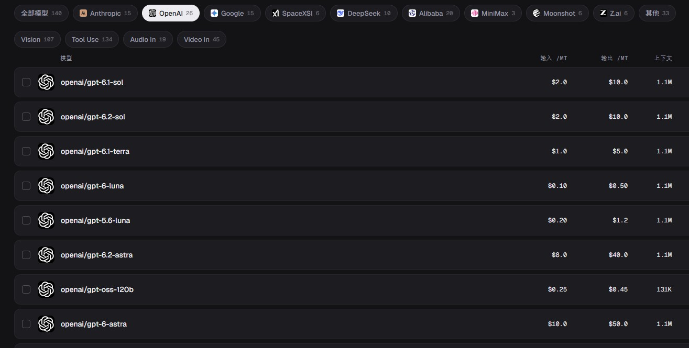
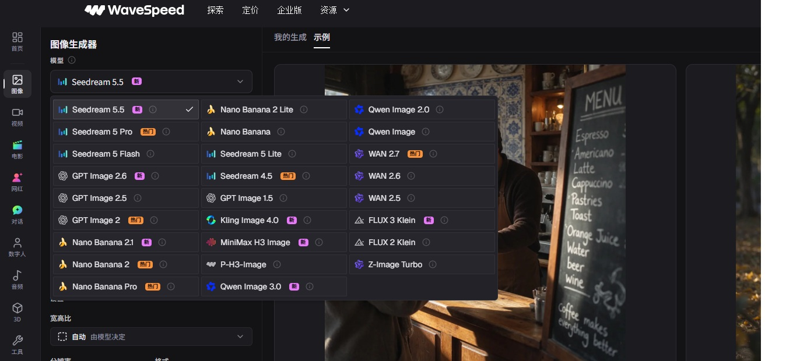
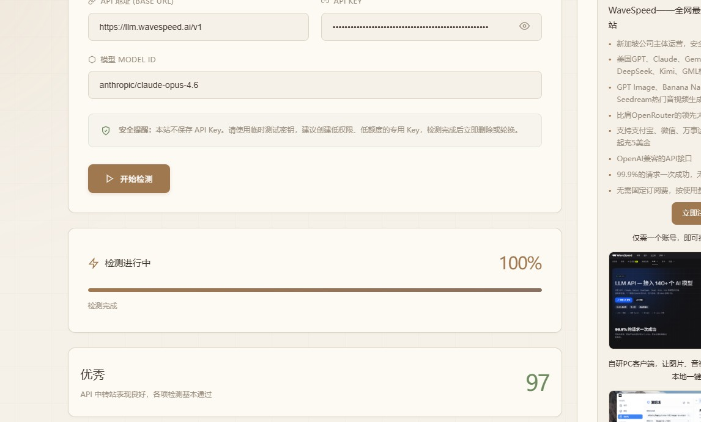
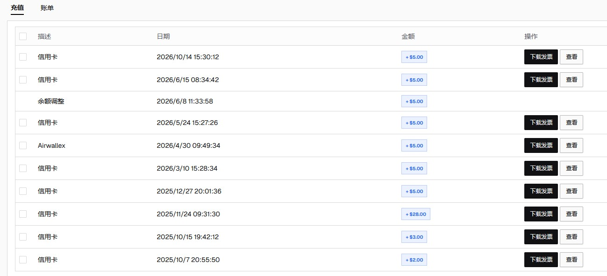
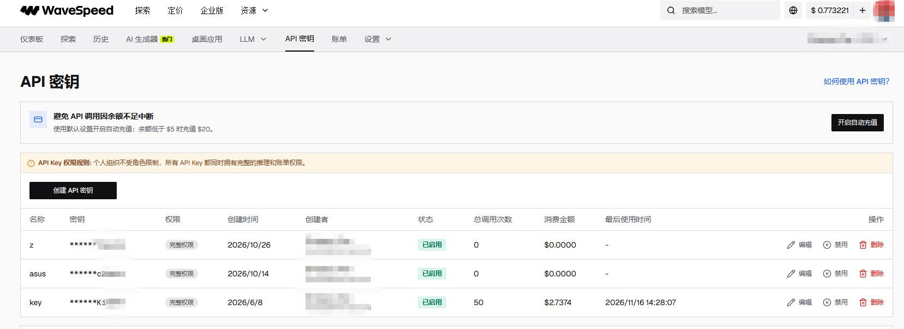
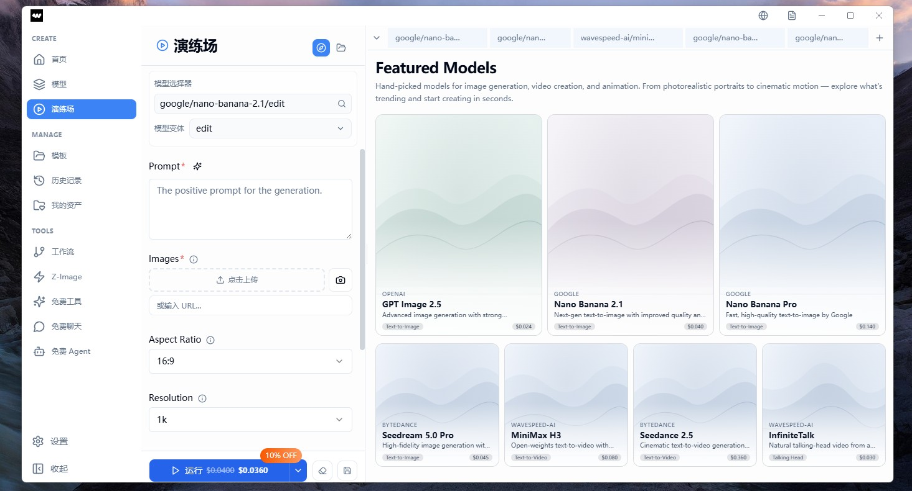
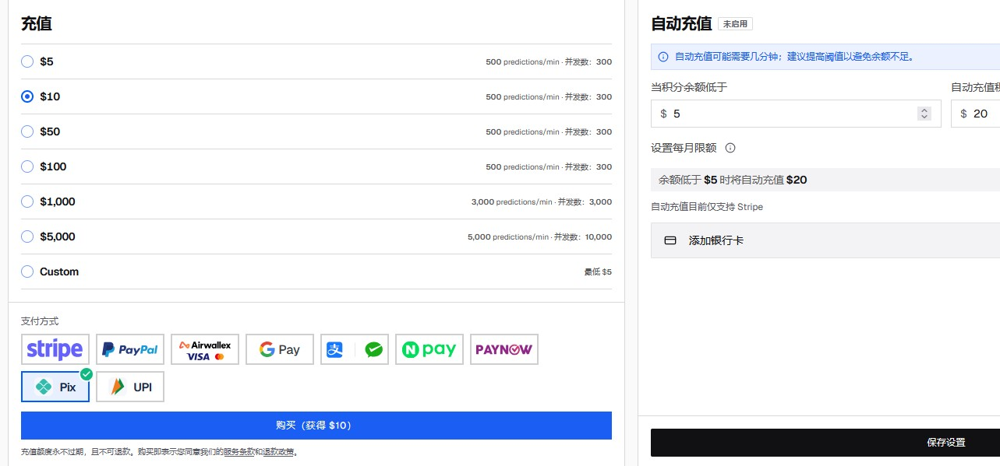

# 30秒一键检测！大模型中转站API真假/注水/掺水/以次充好检测工具网站 | 靠谱的Claude、GPT中转站聚合平台测评推荐

## 文章目录
- [先讲一下这款大模型API检测工具的由来](#先讲一下这款大模型API检测工具的由来)
- [巴士哥中转站API注水掺假真伪检测工具详细介绍](#巴士哥中转站质量检测工具)
- [巴士哥严选——稳定靠谱合规的Claude、GPT全系大模型中转聚合平台测评推荐](#稳定靠谱合规的Claude、GPT全系大模型中转聚合平台测评推荐)

## 先讲一下这款大模型API检测工具的由来

巴士哥乃一大专学历文科生，现在已经是中年大叔了，今年（2026年）我花了半年时间自学AI。刚开始学习各种AI聊天工具的使用，例如DeepSeek、QwenChat、Grok、ChatGPT，当时我用最多的就是QwenChat，这是千问的国际版，除了日常的文案编辑辅助写作外，我主要用它来生成图片和视频，完全免费。

后来迷上了本地部署，由于我当前的电脑是一台已经用了8年的Think Pad X280，日常办公没问题，可要是本地运行大模型，那就不行了，最多部署面壁智能公司的1B MiniCPM小模型运行还算流畅，但这种小模型最多也就能做一些翻译之类的小活儿。于是从京东花了10900元买了一台华硕NUC 16 PRO，这台高性能迷你主机采用的32G统一内存，英特尔B390核显（满血版），我用LM Studio本都部署了一些模型，Qwen系列27B以下的都能流畅输出Token，效果最好的是GPT-OSS-20B模型，响应速度非常快，日常对话或者文案编辑都极其流畅够用，用来编程的话根本不行。另外，LM Studio这款本地部署大模型的工具本身挺好用的，但有些功能过于专业冗余，我只想要个简单的本地部署大模型的方式，其他例如Anything LLM、GPT4ALL等又不好用。后来我搞清楚了，无论是LM Studio还是Ollama，他们的底层都是用的Llama.cpp推理引擎，那我为何不直接在电脑上部署Llama.cpp呢？好嘛，得折腾各种代码，其实耐下心来，代码这些问题还是可以慢慢解决的，但我主要用于实际生产办公，不想在技术上浪费过多时间，就打算使用AI编程工具进行Vibe Codding自己搞产品。于是乎就挑选自己顺手的AI编程工具，初期用的Cursor，这玩意非常好用，每次搞的一些小工具都一气呵成，都能直接使用，于是乎编写了 **[MiniLLM](https://minillm.bashige.com/)**，这款可以一键在Windows中部署Llama.cpp的绿色单文件小工具，无需任何代码，实现一键安装、卸载、启动、停止Llama.cpp服务，用户仅需从Hugging Face下载GGFU格式的模型权重文件放入指定文件夹即可，非常方便好用，支持针对不同GPU的Llama.cpp版本，无论你的电脑是AMD显卡、英伟达显卡、英特尔显卡、还是纯CPU推理，都能安装相应的Llama.cpp版本，实现硬件资源有效利用。并且这款小工具在系统中仅占27M内存，相比LM Studio占用系统500M内存的大块头轻量很多，一键打开WebUI即可与大模型对话，这是我非常满意的一款Vibe Coding作品，大家有需要本地部署大模型的，欢迎下载体验，完全免费，也不含广告，绿色EXE单文件！

后来我又迷上了研究RAG结构化数据。我本身这几年就是做商业文案写作的，经常与文字打交道，大模型之所以如此聪明，都是因为吸收了人类上传的各种内容，包括文字、音频、视频等。文字是基础，而对于大模型来说，最喜欢的是结构化数据，例如Mark Down、JSON等格式，为此我买了一台扫描仪（手机扫描不方便），来把一些线下内容进行OCR识别再进行结构化处理。我把一些长期不看的书籍一张一张撕了，扫描成电子版图片，然后使用工具将其转换为格式化的MD文件，投喂给大模型进行分析处理，例如一些历史书，自己想知道剧情但又没耐心读，那就投喂给大模型进行分析得到书中的答案。结构化数据这块我又折腾了好长时间。

在AI这块，真的是实打实的折腾了半年，由于长期久坐不动，颈椎出现了问题，血脂也高了，还经常头晕，最后不打算沉迷于技术层面了，回归应用为主。

Cursor连续续订了2个月后，不打算续订了，20美元/月并不是付不起，只是我的主业不是编程，偶尔搞一些小活儿，每个月的固定续费有些浪费，更喜欢用多少花多少的Pay As You Go的消费方式，于是最后选择开源的OpenCode，这款AI编程工具除了订阅他家的OpenCode Zen/Go套餐外，还可以通过API外接其他平台的大模型API，这样我就实现了符合我的业务场景的随用随冲的需求。阿里云百炼等平台有一些免费使用Token额度，但额度太少不够用，对比美系的GPT和Claude模型还是有差距，就从网上搜索一些所谓的“中转站”。现在这些大模型中转平台太多了，五花八门，质量上良莠不齐，有些价格便宜的吓人，真不知道到底靠不靠谱。我们消费者不是怕花钱，而是怕花冤枉钱，很多无良商家为了利润最大化，利用技术手段搞了一些猫腻，我这种技术小白也无法轻易分辨。于是搞了一款中转站API注水掺假检测工具，用魔法检测魔法，用来筛选一些稳定靠谱的中转站平台。

## 巴士哥中转站质量检测工具

**[巴士哥AI大模型API中转站真假/注水/掺水检测工具](https://apitest.bashige.com/)**。这款工具可不是简单的连通性测试，而是模拟真实业务请求对API中转站进行10个维度的深度体检，帮用户一站式搞定模型注水与API掺水检测。工具先从基础的连通性与延迟测试看起，评估线路质量，再结合模型列表接口验证排查伪造清单的障眼法。接着深入底层，用OpenAI协议字段合规性检测与基础对话能力测试，揪出二次包装引发的兼容故障和基础罢工。到了最核心的真伪鉴别环节，用123×456的数学计算让以次充好的小模型原形毕露，并在温度0下连问3次相同问题，通过多次请求响应一致性测试精准打击把请求轮询到不同后端的套路。针对中转站喜欢搞的小动作，隐藏Prompt注入探测和系统指令覆盖测试能敏锐捕捉偷偷插播广告或篡改你指令的违规行为。最后，Usage Token字段校验和Function Calling能力测试双管齐下，既严查token计费虚报，又通过工具调用验证协议透传的完整性，全方位确保用户所选的中转站纯净可靠，让每次消费都明明白白。

这款工具的使用方法也特别简单，仅需输入API接口的Base Url、Api Key、Model ID这三项，然后点击开始检测按钮，大约运行30秒左右就可以查看检测报告。评分标准：

- 85-100 优秀 · 可信赖
- 70-84 通过 · 基本可用
- 50-69 风险 · 谨慎使用
- 0-49 高危 · 建议停用

平台不会保存用户的敏感Api Key信息，但还是建议使用一个临时的Api Key，测试完立即删除。当然了，此工具也并不是说100%准确，起到一个参考的作用吧，反正测试一下也没事，总比不测试好吧。

- 2026年7月6日更新：新增支持Claude Fable 5模型检测
- 2026年11月6日更新：修复了一些Bug，让监测更准确。移除了碍眼的Google Adsense广告，让界面更简洁友好。添加了卜算子访客数据统计，根据真实IP统计本监测工具网站真实访客数量。
- 2026年11月11日更新：添加了10项检测原理的详细解说，让用户了解中转站掺水检测的检验逻辑。以及评分标准与结果解读进行详细阐述。添加了常见问题与回答。
- 2026年11月19日更新：重新设计并优化了页面布局。

## 巴士哥严选——稳定靠谱合规的Claude、GPT全系大模型中转聚合平台测评推荐

### 来自新加披公司的大模型聚合中转平台

要说Claude、GPT大模型API中转站的选择，我要说的是必须把“合规”与“稳定靠谱”放在首先，价格重要但还不是最重要的。大模型的API一旦接入，就要长期持续的进行Token传输，对于工作室或者企业来说，把重心放在具体的业务上，而不应该把宝贵的时间浪费在中转站API上面换来换去。

为什么我这里提到“合规”一词呢？市面上目前有很多小作坊经营的中转站，这些中转站如果仅运营Kimi、DeepSeek、Qwen等中国大模型一般没什么事情，但要是运营美国大模型那就存在极高的法律风险了，目前已有一些典型案件，网上可以搜到。中国的大模型备案登记要求极其严格，要求开发者提交《安全评估报告》、语料标注规则、拦截关键词列表，甚至网信办会直接对裸模型进行接口测试和敏感词注入攻击测试。像OpenAI、Anthropic这样的美国大模型公司，其核心权重、训练数据集和对齐机制属于其顶级的商业机密与美国国家关键技术，绝对不可能向中国网信办开放底层的裸模型接口和语料库供中国监管部门进行安全审计。所以，**在中国私下经营美国大模型的那些小作坊中转站不排除会受到执法部门的铁锤，导致运营中断**。

巴士哥我长期以来使用 **[WaveSpeed AI](https://wavespeed.ai/?ref=git)** 这家行业头部的大品牌大模型聚合平台。WaveSpeed AI由新加坡WaveSpeedAI PTE.LTD公司主体运营。基于新加坡独特的地缘区位，在中美AI竞争中能够充分利用其地理、经济和政策优势，避免直接卷入中美贸易战技术战，不受美国出口管制或中国数据本地化要求的直接限制。扮演了连接东西方算力、数据与算法的超级节点，为全球开发者提供兼具安全性、合规性与前沿性的中立实验场，可以自由整合全球优秀的AI大模型资源，服务个人及企业用户，这是其长期稳定运营的核心竞争优势。强烈建议有需要长期使用Claude、ChatGPT、Gemini这类美系大模型的企业及工作室切换为新加披等公司运营的模型提供商，避免所用的不合规中转站受监管打击造成服务中止跑路而影响业务正常开展。

### 账户注册与登陆

**[WaveSpeed AI](https://wavespeed.ai/?ref=git)** 目前不支持Email邮箱注册，需使用GitHub或Google账号直接登陆。您既然现在都看到我这篇GitHub文章了，直接账号登陆不是问题。

### 市面上有的大语言模型、图片音视频生成模型应有尽有！

- 大语言模型包括：Anthropic旗下Claude全系、OpenAI旗下GPT全系、Google公司Gemini全系、SpaceXSI旗下Grok全系、DeepSeek全系、阿里旗下Qwen全系、智普公司Glm全系等。
- 图片音频视频生成模型包括：MiniMax H3、Seedream、Nano Banana、GPT Image、Wan、Keling、Qwen TTS、MiniMax Speech等。

用巴士哥大模型中转站API检测工具进行测试，获得了97分的高分！

### 无需订阅，按使用量收费，高性价比

不同于固定月费订阅方式，WaveSpeed AI采用按使用量计费。比如用Google Nano-Banana-Pro大模型生成一张4K高清图片，单词扣费0.24美元，大语言模型则按Token用量收费。平台有详细计费明细，成本透明、预算可控。我在这里已经消费不少钱了。

### 提供OpenAI兼容的API接口，便于远程调用

通过创建API Key可用于远程调用，适合开发者、独立创作者和企业团队快速接入多模型能力。

### 独家特色——网页及PC桌面客户端的图片音视频创作工作台

如果您是专门做图片或短视频的，那我就更加强烈推荐WaveSpeed AI了。除了在网页端进行图片音视频创作外，他家还有一个PC桌面客户端，这是其他小作坊中转站所没的比的！仅需把所创建的API Key填进去即可使用，可以实时显示账户余额。每次的图片音视频创作都显示具体消耗的金额，便于成本控制。PC桌面客户端还提供包括Z-Image在内的多款完全免费图片视频AI工具，无需API调用，本地运算，电脑配置不能太低哦！

### 支持各种主流支付方式，充值方便

平台最低起充5美元。支持Google Pay、万事达Visa信用卡、支付宝、微信、PayPal、PayNoe等国际主流付款方式，并提供详细充值记录，支付过程丝滑流畅。采用的是Stripe条纹、Airwallex空中云汇等顶级支付网关，即便用信用卡付款也不必担心卡号安全问题。

纵观市面上各种五花八门的中转站，我认为WaveSpeed是市面上最好的了，平台老板是用心做产品的，你就安心稳定用就行，根本不必担心什么注水跑路问题。**[立即注册WaveSpeed AI!](https://wavespeed.ai/?ref=git)**

## 分享我用AI编程工具做的一些作品，文科生搞编程，让各位见笑了

- [Voice Recorder Online](https://recorder.bashige.com/)，一款在线录音机，支持降噪，支持录制麦克风和电脑媒体声音
- [Free Online OCR](https://ocr.bashige.com/)，一款免费在线的图片识别文字OCR工具，纯浏览器运行，采用了传统的Tesseract OCR引擎，快速高效
- [千里江山图在线赏析](https://qianlijiangshan.bashige.com/)，在线欣赏名画《千里江山图》，可放大6000倍看图片细节
- [Best Guitar Tuner](https://guitartuner.bashige.com/)，免费在线的吉他调音器
