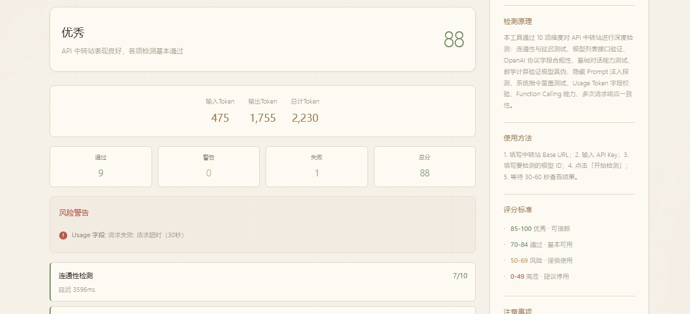

# 30秒一键检测！大模型中转站API真假/注水/掺水/以次充好检测工具网站

## 先讲一下这款大模型API检测工具的由来

巴士哥乃一文科生，现在已经是中年大叔了，今年（2026年）我花了半年时间自学AI。刚开始学习各种AI聊天工具的使用，例如豆包、DeepSeek、QwenChat，当时我用最多的就是QwenChat，这是千问的国际版，除了日常的文案编辑辅助写作外，我主要用它来生成图片和视频，完全免费。

后来迷上了本地部署，由于我当前的电脑是一台已经用了8年的Think Pad X280，日常办公没问题，可要是本地运行大模型，那就不行了，最多部署面壁智能公司的1B MiniCPM小模型运行还算流畅，但这种小模型最多也就能做一些翻译之类的小活儿。于是从京东花了10900元买了一台华硕NUC 16 PRO，这台高性能迷你主机采用的32G内存，英特尔B390核显（满血版），我用LM Studio本都部署了一些模型，Qwen系列27B以下的都能流畅输出Token，效果最好的是GPT-OSS-20B模型，响应速度非常快，日常对话或者文案编辑都极其流畅。但我发现，LM Studio这款本地部署大模型的工具本身挺好用的，但有些功能过于专业冗余，我只想要个简单的本地部署大模型的方式。后来我搞清楚了，无论是LM Studio还是Ollama，他们的底层都是用的Llama.cpp推理引擎，那我为何不直接在电脑上部署Llama.cpp呢？好嘛，得折腾各种代码，其实耐下心来，代码这些问题还是可以慢慢解决的，但我主要用于实际生产办公，不想在技术上浪费过多时间，就打算使用AI编程工具进行Vibe Codding自己搞产品。于是乎就挑选自己顺手的AI编程工具，初期用的Cursor，这玩意非常好用，每次搞的一些小工具都一气呵成，都能直接使用，于是乎编写了[MiniLLM](https://minillm.bashige.com/)，这款可以一键在Windows中部署Llama.cpp的绿色单文件小工具，无需任何代码，实现一键安装、卸载、启动、停止Llama.cpp服务，用户仅需从Hugging Face下载GGFU格式的模型权重文件放入指定文件夹即可，非常方便好用，支持针对不同GPU的Llama.cpp版本，无论你的电脑是AMD显卡、英伟达显卡、英特尔显卡、还是纯CPU推理，都能安装相应的Llama.cpp版本，实现硬件资源有效利用。并且这款小工具在系统中仅占27M内存，相比LM Studio占用系统500M内存的大块头轻量很多，一键打开WebUI即可与大模型对话，这是我非常满意的一款Vibe Coding作品，大家有需要本地部署大模型的，欢迎下载体验，完全免费，也不含广告，绿色EXE单文件！

后来我又迷上了研究RAG结构化数据。我本身这几年就是做商业文案写作的，经常与文字打交道，大模型之所以如此聪明，都是因为吸收了人类上传的各种内容，包括文字、音频、视频等。文字是基础，而对于大模型来说，最喜欢的是结构化数据，例如Mark Down、JSON等格式，为此我买了一台扫描仪（手机扫描不方便），来把一些线下内容进行OCR识别再进行结构化处理。我把一些长期不看的书籍一张一张撕了，扫描成电子版图片，然后使用工具将其转换为格式化的MD文件，投喂给大模型进行分析处理，例如一些历史书，自己想知道剧情但又没耐心读，那就投喂给大模型进行分析得到书中的答案。结构化数据这块我又折腾了好长时间。

在AI这块，真的是实打实的折腾了半年，由于长期久坐不动，颈椎出现了问题，血脂也高了，还经常头晕，最后不打算沉迷于技术层面了，回归应用为主。

Cursor连续续订了2个月后，不打算续订了，20美元/月并不是付不起，只是我的主业不是编程，偶尔搞一些小活儿，每个月的固定续费有些浪费，更喜欢用多少花多少的Pay As You Go的消费方式，于是最后选择开源的OpenCode，这款AI编程工具除了订阅他家的OpenCode Zen/Go套餐外，还可以通过API外接其他平台的大模型API。阿里百炼平台有一些免费使用Token额度，但额度太少不够用，对比美系的GPT和Claude模型还是有差距，就从网上搜索一些所谓的“中转站”。现在这些大模型中转平台太多了，五花八门，质量上良莠不齐，有些价格便宜的吓人，真不知道到底靠不靠谱。我们消费者不是怕花钱，而是怕花冤枉钱，很多无良商家为了利润最大化，利用技术手段搞了一些猫腻，我这种技术小白也无法轻易分辨。于是搞了一款中转站API注水掺假检测工具，用魔法检测魔法，用来严选一些稳定靠谱的中转站平台。

## 巴士哥中转站质量检测工具

这里我推荐这款“**[巴士哥AI大模型API中转站真假/注水/掺水检测工具](https://apitest.bashige.com/)**”。

这个工具可不是简单的连通性测试，而是模拟真实业务请求对API中转站进行10个维度的深度体检，帮你一站式搞定模型注水与API掺水检测。我们先从基础的连通性与延迟测试看起，评估线路质量，再结合模型列表接口验证排查伪造清单的障眼法。接着深入底层，用OpenAI协议字段合规性检测与基础对话能力测试，揪出二次包装引发的兼容故障和基础罢工。到了最核心的真伪鉴别环节，我们会用123×456的数学计算让以次充好的小模型原形毕露，并在温度0下连问3次相同问题，通过多次请求响应一致性测试精准打击把请求轮询到不同后端的套路。针对中转站喜欢搞的小动作，隐藏Prompt注入探测和系统指令覆盖测试能敏锐捕捉偷偷插播广告或篡改你指令的违规行为。最后，Usage Token字段校验和Function Calling能力测试双管齐下，既严查token计费虚报，又通过工具调用验证协议透传的完整性，全方位确保你的中转站纯净可靠，让每次调用都明明白白。

这款工具的使用方法也特别简单，仅需输入API接口的Base Url、Api Key、Model ID这三项，然后点击开始检测按钮，大约运行30秒左右就可以查看检测报告。评分标准：

- 85-100 优秀 · 可信赖
- 70-84 通过 · 基本可用
- 50-69 风险 · 谨慎使用
- 0-49 高危 · 建议停用

平台不会保存用户的敏感Api Key信息，但还是建议使用一个临时的Api Key，测试完立即删除。当然了，此工具也并不是说100%准确，起到一个参考的作用吧，反正测试一下也没事，总比不测试好吧。

- 2026年7月6日更新：新增支持Claude Fable 5模型检测
- 2026年11月6日更新：修复了一些Bug，让监测更准确。移除了碍眼的Google Adsense广告，让界面更简洁友好。添加了卜算子访客数据统计，根据真实IP统计本监测工具网站真实访客数量。
- 2026年11月11日更新：添加了10项检测原理的详细解说，让用户了解中转站掺水检测的检验逻辑。以及评分标准与结果解读进行详细阐述。添加了常见问题与回答。
- 2026年11月19日更新：重新设计并优化了页面布局。

